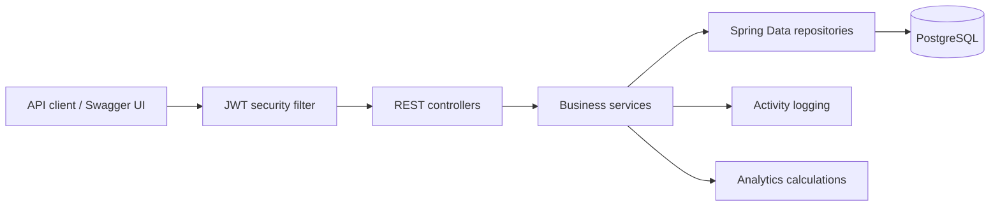
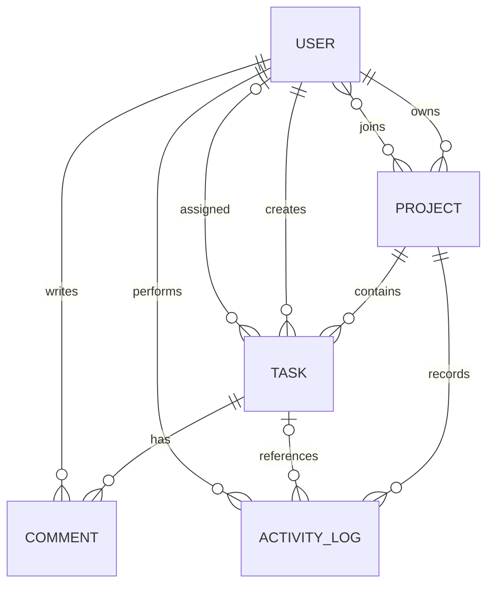

# FlowForge

FlowForge is a production-style REST API for coordinating projects, assigning work,
tracking task progress, collaborating through comments, and understanding team workload.
It is designed as a readable Java portfolio project: the architecture is layered, the
business rules are tested, and the entire local stack can be started with Docker Compose.

## Highlights

- JWT registration and login with BCrypt password hashing
- Role-based access for `ADMIN`, `MANAGER`, and `MEMBER`
- Project ownership, membership, lifecycle, and completion tracking
- Validated task workflow: `TODO → IN_PROGRESS → REVIEW → DONE`, with blocking/reopening
- Assignment, priority, due-date, overdue, text search, filtering, sorting, and pagination
- Task comments with author and project-owner moderation rules
- Audit-friendly project activity timeline
- Personal dashboard and per-project workload/completion analytics
- Consistent validation and JSON error responses
- OpenAPI documentation with interactive Swagger UI
- PostgreSQL persistence, Docker Compose, and profile-scoped demo data
- Unit and integration tests backed by an isolated H2 database

## Technology

| Area | Technology |
|---|---|
| Language | Java 21 |
| Framework | Spring Boot 4.0.8, Spring MVC |
| Security | Spring Security, JWT (JJWT), BCrypt |
| Persistence | Spring Data JPA, Hibernate, PostgreSQL |
| API docs | Springdoc OpenAPI / Swagger UI |
| Testing | JUnit 6, Mockito, MockMvc, AssertJ, H2 |
| Build | Maven Wrapper |
| Runtime | Docker, Docker Compose |

## Architecture



The controller layer only handles HTTP concerns. Services enforce authorization and
workflow rules, repositories isolate persistence, and DTOs keep database entities out
of the public API contract.

## Data model



## Project structure

```text
flowforge-java/
├── src/main/java/com/flowforge/
│   ├── config/       # security, OpenAPI, clock, demo profile
│   ├── controller/   # REST endpoints
│   ├── dto/          # request and response contracts
│   ├── entity/       # JPA entities
│   ├── enums/        # roles, states, priorities, actions
│   ├── exception/    # domain exceptions and global handling
│   ├── repository/   # Spring Data repositories/specifications
│   ├── security/     # JWT filter and user details
│   └── service/      # authorization and business logic
├── src/main/resources/application.yml
├── src/test/         # unit and API integration tests
├── compose.yml
├── Dockerfile
└── pom.xml
```

## Run with Docker Compose

Requirements: Docker with the Compose plugin.

```bash
cp .env.example .env
# Replace JWT_SECRET and passwords in .env before shared/hosted use.
docker compose up --build
```

The API runs at `http://localhost:8080`. PostgreSQL data is retained in the
`flowforge-data` volume. Stop the containers with `docker compose down`; add `-v`
only when you intentionally want to delete the local database.

The default Compose configuration enables the `dev` profile and creates sample data
only when the user table is empty. Demo accounts all use `FlowForge123!`:

- `admin@flowforge.dev`
- `manager@flowforge.dev`
- `member@flowforge.dev`

Never enable the `dev` profile or use these credentials in a deployed environment.

## Run locally

Requirements: JDK 21+ and PostgreSQL 14+.

```bash
createdb flowforge
export DB_USERNAME=flowforge
export DB_PASSWORD=your-password
export JWT_SECRET=your-base64-encoded-32-byte-or-longer-secret
./mvnw spring-boot:run
```

Generate a suitable local secret on macOS or Linux with:

```bash
openssl rand -base64 48
```

To opt into the development sample data, add
`SPRING_PROFILES_ACTIVE=dev` before starting the application.

## Build and test

The Maven Wrapper means a system Maven installation is not required.

```bash
./mvnw clean test
./mvnw clean package
java -jar target/flowforge-java-0.0.1-SNAPSHOT.jar
```

Tests use the `test` profile and an in-memory H2 database; they do not alter a local
PostgreSQL database.

## API documentation

After startup:

- Swagger UI: `http://localhost:8080/swagger-ui.html`
- OpenAPI JSON: `http://localhost:8080/v3/api-docs`
- Health check: `http://localhost:8080/actuator/health`

Register or log in, copy the returned token, then use Swagger's **Authorize** button.

## Example API flow

Register a member:

```bash
curl -X POST http://localhost:8080/api/auth/register \
  -H 'Content-Type: application/json' \
  -d '{"firstName":"Ada","lastName":"Lovelace","email":"ada@example.com","password":"strong-pass"}'
```

Log in as the demo manager and store the token (requires `jq`):

```bash
TOKEN=$(curl -s -X POST http://localhost:8080/api/auth/login \
  -H 'Content-Type: application/json' \
  -d '{"email":"manager@flowforge.dev","password":"FlowForge123!"}' | jq -r '.token')
```

Create a project and list the current user's projects:

```bash
curl -X POST http://localhost:8080/api/projects \
  -H "Authorization: Bearer $TOKEN" \
  -H 'Content-Type: application/json' \
  -d '{"name":"Website Launch","description":"Coordinate the public launch","status":"ACTIVE"}'

curl http://localhost:8080/api/projects \
  -H "Authorization: Bearer $TOKEN"
```

Create and filter tasks (replace `1` with a project ID):

```bash
curl -X POST http://localhost:8080/api/projects/1/tasks \
  -H "Authorization: Bearer $TOKEN" \
  -H 'Content-Type: application/json' \
  -d '{"title":"Review landing page","priority":"HIGH","dueDate":"2027-01-15T18:00:00Z"}'

curl 'http://localhost:8080/api/projects/1/tasks?priority=HIGH&sort=dueDate,asc' \
  -H "Authorization: Bearer $TOKEN"
```

Read dashboard metrics:

```bash
curl http://localhost:8080/api/dashboard \
  -H "Authorization: Bearer $TOKEN"
```

## Principal endpoints

| Method and path | Purpose |
|---|---|
| `POST /api/auth/register`, `POST /api/auth/login` | Authentication |
| `GET/POST /api/projects` | List accessible projects / create project |
| `GET/PUT /api/projects/{id}` | Project detail / update |
| `POST/DELETE /api/projects/{id}/members/{userId}` | Membership management |
| `GET/POST /api/projects/{id}/tasks` | Filtered task list / create task |
| `GET/PUT/DELETE /api/tasks/{id}` | Task detail / update / delete |
| `PATCH /api/tasks/{id}/status` | Validated workflow transition |
| `PATCH /api/tasks/{id}/assignee` | Assign a project member |
| `GET /api/tasks/search?q=...` | Search accessible tasks |
| `GET /api/tasks/overdue` | List accessible overdue tasks |
| `GET/POST /api/tasks/{id}/comments` | List / add comments |
| `GET /api/projects/{id}/activity` | Project activity timeline |
| `GET /api/dashboard` | Personal workload summary |
| `GET /api/projects/{id}/analytics` | Project metrics |

## Roles and permissions

- `MEMBER`: sees joined projects, updates tasks they created or are assigned, comments,
  and views their dashboard.
- `MANAGER`: includes member abilities and can create projects. A project's owner manages
  that project's members, assignments, lifecycle, and deletions.
- `ADMIN`: can access all projects, manage users' roles, and perform project-owner actions.

Every protected route also checks resource-level access in the service layer; possessing
a valid JWT does not grant access to unrelated projects.

## Configuration

| Variable | Default | Description |
|---|---|---|
| `DB_HOST` | `localhost` | PostgreSQL hostname |
| `DB_PORT` | `5432` | PostgreSQL port |
| `DB_NAME` | `flowforge` | Database name |
| `DB_USERNAME` | `flowforge` | Database user |
| `DB_PASSWORD` | `flowforge` | Database password |
| `JWT_SECRET` | local development value | Base64 HMAC secret; replace outside local use |
| `JWT_EXPIRATION` | `24h` | Token lifetime |
| `SERVER_PORT` | `8080` | HTTP port |
| `SPRING_PROFILES_ACTIVE` | none | Use `dev` only for local demo records |

## Error format

Validation, authorization, conflicts, and missing resources share one response shape:

```json
{
  "timestamp": "2026-10-06T20:00:00Z",
  "status": 400,
  "error": "Bad Request",
  "message": "Request validation failed",
  "path": "/api/auth/register",
  "validationErrors": {"email": "must be a well-formed email address"}
}
```

## Future improvements

- Refresh tokens and token revocation
- Flyway database migrations for controlled production schema changes
- Email and webhook notifications
- File attachments and labels
- CI pipeline with Testcontainers against PostgreSQL
- Frontend client and deployable cloud infrastructure

## License

This project is provided for educational and portfolio use.
